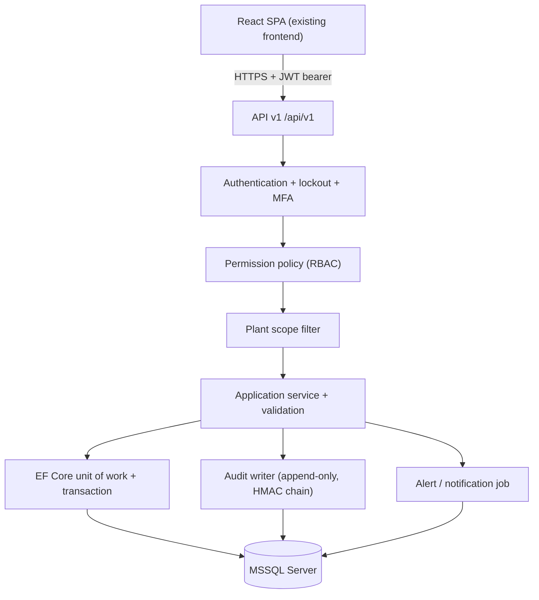

# Backend Setup Plan

> [!info] What this note is
> The build plan for the backend of the FCCL IT Asset & Infrastructure Management Platform. It turns the requirements specification into a concrete engineering sequence: stack, solution layout, schema, API surface, cross-cutting rules, test strategy and acceptance mapping.
>
> **It is a plan, not a status report.** Nothing in it is built. Where the documents disagree with each other, this note names the conflict and proposes a default rather than silently picking one.

**Requirements source:** [[Asset_Management_Requirements_Specification]] (FR-001…FR-024, NFR-001…NFR-011, AC-01…AC-11, Appendix B).
**Decisions layer:** [[08-decisions-and-open-issues]] · [[02-architecture-and-technology]] · [[03-roles-and-access-control]].
**Current code reality:** [[Project Map]].

---

## 1. Scope and precedence

The specification is the authority for **what** the backend must do. It is not the authority for **how** — its §14.1 stack (Next.js, NestJS, PostgreSQL/Prisma, Keycloak, Redis, BullMQ, Docker/NGINX) has been superseded by later user-confirmed decisions. This plan therefore uses:

| Concern | Source of truth | Consequence for this plan |
|---|---|---|
| Features, FRs, ACs | Specification §6–§13, §17 | Endpoint and test coverage is driven by FR IDs |
| Stack, ORM, database | [[02-architecture-and-technology]] | ASP.NET Core + EF Core + MSSQL Server |
| Roles and plant isolation | [[03-roles-and-access-control]] | System Admin, Admin, Employee, Auditor; server-side scope on every query |
| Reportable conflicts | [[08-decisions-and-open-issues]] | §9 gates below; do not build past an unanswered gate |

Known conflicts this plan does **not** resolve on its own (they are §9 gates): FR-024 vs Appendix B, role naming, lifecycle status set, asset identifier, timestamp storage (UTC vs NFR-006 "stored in PKT", marked Confirmed), 2FA mechanism, and whether "basic monitoring" in the spec's Phase 1 table overrides the deferred-monitoring decision.

> [!warning] The current `backend/` folder is not this backend
> `backend/server.ts` is a 319-line Express prototype that imports TypeScript directly from `frontend/src/utils` and `backend/data/mockInventoryData.ts`, holds all state in module-level arrays, and authenticates by trusting an `x-user-role` request header. It cannot be extended into the target system: wrong runtime, wrong language, no database, no real authentication, no plant isolation. It is treated as a **behavioural reference only** (§8) and is archived in WP0.

---

## 2. Target architecture

A modular monolith. Not microservices, not a separate auth server. One deployable API, four logical modules, one database.



**Non-negotiable rules** (each maps to a requirement or an existing risk):

1. **Permission checks happen in the API, never in the SPA.** [[03-roles-and-access-control]] §7; FR-024 blocked-access logging depends on it.
2. **Plant scope is applied to every query and every write**, for every role, including `GET /assets/{id}`. BO-7 / AC-02.
3. **No plant ID is ever trusted from the request body or query string** without a claim check. FR-003.
4. **Statuses live in lookup tables, not C# enums.** Risk K-07 in [[Project Map]]: the status sets have already changed once.
5. **Audit writes are part of the business transaction boundary** and never silently skipped. FR-024.
6. **The API does not import frontend code.** The current direction of dependency (`backend/server.ts` → `frontend/src/utils/*`) is reversed today and must not survive.

---

## 3. Toolchain baseline

| Item | Choice | Notes |
|---|---|---|
| Runtime | **.NET 10 LTS** (`net10.0`) | Released 11 Nov 2025, supported to 14 Nov 2028. .NET 8 exited support 10 Nov 2026 — do not start a new project on it. |
| Web framework | ASP.NET Core Web API, controller-based | Controllers + `[ApiController]` keep the FR→endpoint traceability table readable; minimal APIs are acceptable per module if preferred. |
| ORM | EF Core 10 + `Microsoft.EntityFrameworkCore.SqlServer` | Migrations in `FCCL.Inventory.Infrastructure`. |
| Database (local) | SQL Server 2022 Developer, or LocalDB | Confirm edition/version with FCCL IT (OI-05, [[07-backup-deployment-and-recovery]] §6). Express has no Agent — see that note's backup caveat. |
| Identity store | ASP.NET Core Identity (`AddIdentityCore`) for password hashing, lockout and user records; JWT issued by us | Removes the hand-rolled SHA-256 digit-hash scheme in `frontend/src/utils/authService.ts`. |
| Tokens | `Microsoft.AspNetCore.Authentication.JwtBearer` | Access token 15–30 min; refresh token stored hashed, rotated. |
| Validation | DataAnnotations for shape, FluentValidation for business rules | Rules that need the DB (uniqueness, stock) stay in services. |
| API docs | `Microsoft.AspNetCore.OpenApi` + Swagger UI | D-14 "API documents" deliverable. |
| Logging | Serilog → console + rolling file; correlation ID per request | No PII in logs. |
| Tests | xUnit + `WebApplicationFactory` + FluentAssertions; Testcontainers or a dedicated test DB | Project names already fixed in [[02-architecture-and-technology]] §5. |
| Local secrets | `dotnet user-secrets` | Never in `appsettings*.json`, never committed ([[07-backup-deployment-and-recovery]] §4). |
| SDK pinning | `global.json` with `rollForward: latestFeature` | Prevents "works on my machine" SDK drift. |

Frontend stays React + TypeScript + Vite. Node is only needed for the SPA and tooling.

---

## 4. WP0 — Archive the prototype, scaffold the solution

**Goal:** an empty solution that builds, migrates and serves `/health` before any feature work.

```powershell
# 1. Preserve the Express prototype in history, then clear the folder
git tag backend-express-prototype
git mv backend backend-legacy
New-Item -ItemType Directory backend

# 2. Solution + projects (layout from Docs/02-architecture-and-technology.md §5)
dotnet new sln -n FCCL.Inventory -o backend
dotnet new webapi -n FCCL.Inventory.Api          -o backend/src/FCCL.Inventory.Api
dotnet new classlib -n FCCL.Inventory.Application -o backend/src/FCCL.Inventory.Application
dotnet new classlib -n FCCL.Inventory.Domain      -o backend/src/FCCL.Inventory.Domain
dotnet new classlib -n FCCL.Inventory.Infrastructure -o backend/src/FCCL.Inventory.Infrastructure
dotnet new xunit  -n FCCL.Inventory.UnitTests          -o backend/tests/FCCL.Inventory.UnitTests
dotnet new xunit  -n FCCL.Inventory.IntegrationTests   -o backend/tests/FCCL.Inventory.IntegrationTests
dotnet new xunit  -n FCCL.Inventory.AuthorizationTests -o backend/tests/FCCL.Inventory.AuthorizationTests
dotnet sln backend/FCCL.Inventory.sln add (Get-ChildItem backend -Recurse -Filter *.csproj)

# 3. Packages
dotnet add backend/src/FCCL.Inventory.Infrastructure package Microsoft.EntityFrameworkCore.SqlServer --version 10.*
dotnet add backend/src/FCCL.Inventory.Infrastructure package Microsoft.EntityFrameworkCore.Design --version 10.*
dotnet add backend/src/FCCL.Inventory.Infrastructure package Microsoft.AspNetCore.Identity.EntityFrameworkCore --version 10.*
dotnet add backend/src/FCCL.Inventory.Api package Microsoft.AspNetCore.Authentication.JwtBearer --version 10.*
dotnet add backend/src/FCCL.Inventory.Api package Serilog.AspNetCore
dotnet tool install --global dotnet-ef
```

**Dependency direction:** `Api → Application → Domain`; `Infrastructure → Application` (implements interfaces) and is referenced only by `Api` for DI wiring. `Domain` references nothing.

**Definition of done for WP0**

- [ ] `dotnet build` and `dotnet test` exit 0 from a clean clone.
- [ ] `GET /health` returns 200; `/health/ready` checks the DB.
- [ ] Swagger UI opens locally and shows the JWT authorise button.
- [ ] `dotnet ef migrations add InitialCreate` produces an empty-but-valid migration against a local DB.
- [ ] `backend-legacy/` builds nothing, is excluded from the solution, and is deleted once the port table (§8) is signed off.
- [ ] `.gitignore` ignores `bin/`, `obj/`, `*.user`, `appsettings.*.local.json`.

---

## 5. Work packages and sequence

Backend-first per [[01-project-overview]] §7. Each work package ends with a demoable API + tests, not a UI.

| WP | Content | FRs | Phase | Exit criteria |
|---|---|---|---|---|
| **WP0** | Solution scaffold, health checks, CI command set | — | Prereq | §4 checklist |
| **WP1** | Plants, users, auth, RBAC policies, plant scope, audit spine | FR-001, 002, 003, 024 | 1 | Login + lockout + MFA stub; every endpoint denies out-of-scope plants; failed sign-ins audited (AC-01, AC-09) |
| **WP2** | Asset types, custom fields, lookup lists, assets, lifecycle, archive/disposal | FR-004, 005, 006, 018 (basic) | 1 | Create/search/edit/archive; duplicate tag blocked; 42U/48U rack heights honoured |
| **WP3** | Employees, assignments, returns, leavers | FR-007, 008, 009 | 1 | Full custody history; leaver report; employee self-view |
| **WP4** | Transfers, dispatch/receipt, gate passes, QR labels | FR-010, 011, 012, 020 (basic) | 1 | State machine enforced; inter-plant move needs System Admin approval; gate pass PDF/QR |
| **WP5** | Work orders, transitions, parts used, vendors on WO | FR-013, 014, 016 (vendors), 017 (warranty) | 1 | Asset optional at creation; 8-state machine; asset status side effects; overdue flag |
| **WP6** | Audit search/export, alerts, import/export, dashboard aggregates | FR-021, 022, 023, 024 | 1 | Export is itself audited; import produces row-level error report; dashboard totals scoped |
| **WP7** | Stock items + transactions + thresholds | FR-015 | 2 | No negative stock under concurrency; every movement a row |
| **WP8** | Contracts, licences, change requests, physical audit findings, rack visual data | FR-017 (contracts), 019, 020 (findings) | 2 | Findings require approval, never auto-correct |
| **WP9** | Hardening: performance pass, rate limits, security review fixes, backup/restore drill | NFR-001, 004, 011; AC-10, AC-11 | 2 | Load test at planning size; restore proven |

**Ordering constraint:** WP1 must be finished before WP2 starts. Plant scope and the audit writer are cross-cutting; retrofitting them is risk K-05 in [[Project Map]], and it is the most expensive mistake available on this project.

**Pilot reality check:** the spec's Phase 1 baseline is four weeks with four developers and is explicitly a target, not a deadline. WP1–WP3 alone will consume most of that if the §9 gates stay open. Publish a trimmed Phase-1 cut (auth + plants + assets + assignment + audit) and treat WP4–WP6 as negotiable rather than discovering the overrun in week three.

---

## 6. Data model

Physical schema in MSSQL. All tables: `Id uniqueidentifier` PK (or `int identity` for append-only logs), `CreatedAtUtc datetime2(3)`, `CreatedBy uniqueidentifier`, `RowVersion rowversion` where concurrent edits matter.

### 6.1 Core tables

| Table | Key columns | Constraints / indexes |
|---|---|---|
| `Plants` | Id, Code, Name, City, Type (HeadOffice/Plant), IsActive | `UQ Plants.Code` |
| `Locations` | Id, PlantId, ParentLocationId, Name, Kind (Building/Room/Rack) | Index `(PlantId, ParentLocationId)`; FK to Plants |
| `AspNetUsers` (Identity) | Id, UserName, Email, PasswordHash, EmployeeId?, IsActive, LockoutEnd, TwoFactorEnabled | `UQ UserName`; never delete, deactivate |
| `UserPlantAccess` | UserId, PlantId, Scope | Composite PK; no row ⇒ no access |
| `Employees` | Id, PlantId, EmployeeNumber, Name, Department, JobTitle, WorkEmail, WorkPhone, Status | `UQ (PlantId, EmployeeNumber)`; minimal PII only (NFR-007) |
| `AssetTypes` | Id, Name, Code, Version, IsActive | `UQ Code` |
| `AssetTypeFields` | Id, AssetTypeId, Key, Label, DataType, IsRequired, OptionsJson | Drives dynamic form + validation (FR-005) |
| `LookupValues` | Id, ListKey (AssetStatus/WorkOrderStatus/Priority/Department/Category), Code, Label, SortOrder, IsActive | `UQ (ListKey, Code)` — replaces enums (K-07) |
| `Assets` | Id, AssetTag, SerialNumber, AssetTypeId, Brand, Model, StatusCode, PlantId, LocationId, RackId?, RackUnitStart decimal(4,1)?, RackUnitHeight decimal(4,1)?, RackFace?, AssignedEmployeeId?, VendorId?, PurchaseDate, PurchaseCostPKR decimal(18,2), WarrantyStart, WarrantyEnd, Hostname, MacAddress, IpAddress, Notes, IsArchived, DisposedAtUtc, RowVersion | `UQ (PlantId, AssetTag)`; index `(PlantId, StatusCode)`, `(PlantId, AssetTypeId)`, `SerialNumber`; check `RackUnitStart > 0 AND RackUnitStart + RackUnitHeight - 1 <= 48`; **no hard delete** |
| `AssetCustomValues` | AssetId, AssetTypeFieldId, ValueText, ValueNumber, ValueDate | PK `(AssetId, AssetTypeFieldId)`; or an EF Core 10 JSON column if profiling says the join hurts |
| `AssetAssignments` | Id, AssetId, EmployeeId, StartAtUtc, EndAtUtc?, ReceiptConfirmedAtUtc?, ReturnConfirmedAtUtc?, Reason, ActorUserId | Index `(AssetId, StartAtUtc)`; one open assignment per asset enforced in a filtered unique index |
| `AssetTransfers` | Id, AssetId, FromPlantId, ToPlantId, StatusCode, RequestedBy, RequestedAtUtc, ApprovedBy, ApprovedAtUtc, DispatchedAtUtc, ReceivedAtUtc, Condition, TransportDetails, RejectReason | 7-state machine (FR-010) |
| `GatePasses` | Id, PassNumber, PlantId, AssetId, IssuedTo, ValidFrom, ValidTo, ApprovedBy, GateCheckedBy?, GateCheckedAtUtc?, QrPayload | `UQ PassNumber` |
| `Vendors` | Id, Code, Name, Type, ContactPerson, Phone, Email, Address, TaxNumber, PlantsServedJson, IsActive | `UQ Code`; soft-inactivate (FR-016) |
| `VendorContracts` | Id, VendorId, Kind, StartDate, EndDate, Coverage, RenewalReminderDays | Index `EndDate` |
| `Warranties` | Id, AssetId, StartDate, EndDate, Terms | Optional 1:1 with Assets; drives FR-021 alert |
| `StockItems` | Id, PlantId, Sku, Name, Category, VendorId?, UnitPricePKR decimal(18,2), MinThreshold, ReorderPoint, LeadTimeDays, ShelfLocation, RowVersion | `UQ (PlantId, Sku)`; check `MinThreshold >= 0` |
| `StockTransactions` | Id, StockItemId, PlantId, Type (Receipt/Issue/Return/Transfer/Adjustment), Quantity int, ActorUserId, OccurredAtUtc, Reason, WorkOrderId?, AssetId?, PurchaseOrderId? | Append-only; index `(StockItemId, OccurredAtUtc)`; `Quantity > 0` |
| `WorkOrders` | Id, Number, PlantId, LocationId?, AssetId?, Title, Description, PriorityCode, StatusCode, WorkType, ReporterUserId, AssignedUserId?, VendorId?, CreatedAtUtc, DueAtUtc?, ResolvedAtUtc?, ClosedAtUtc?, VerifiedBy?, PartsCostPKR, TimeSpentMinutes, RowVersion | `UQ Number`; index `(PlantId, StatusCode)`, `(DueAtUtc)` |
| `WorkOrderHistory` | Id, WorkOrderId, FromStatus, ToStatus, ChangedBy, ChangedAtUtc, Note | Immutable; drives the state-machine audit |
| `Documents` | Id, PlantId, EntityType, EntityId, FileName, ContentType, SizeBytes, StorageKey, UploadedBy | Store files outside the DB; path in DB |
| `Alerts` | Id, PlantId, Kind, EntityType, EntityId, DueAtUtc, RecipientsJson, AcknowledgedAtUtc? | Unique per (Kind, EntityId, DueDate) to prevent duplicates |
| `ImportJobs` / `ImportErrors` | Id, Kind, FileName, RequestedBy, Status, RowNumber, Field, Message | Error report is a deliverable (FR-022) |
| `AuditEntries` | Id bigint identity, Sequence, OccurredAtUtc, ActorUserId?, ActorDisplay, ActorRole, PlantId?, Action, EntityType, EntityId, OldValuesJson, NewValuesJson, ChangesSummary, IsSystemAction, PreviousHash, RecordHash, CorrelationId | Append-only; indexes `(OccurredAtUtc)`, `(EntityType, EntityId)`, `(PlantId, OccurredAtUtc)`, `(ActorUserId)` |
| `AuditSessions` / `AuditFindings` | SessionId, PlantId, StartedAtUtc, ApprovedBy?, ApprovedAtUtc?; Finding: ExpectedLocation, ScannedLocation, DiscrepancyType, ResolutionStatus | Findings are reviewed, never auto-corrected (FR-020) |

### 6.2 Rules that belong in the schema, not only in code

- **Unique asset tag per plant**, never reused, including after archive. A partial unique index on `(PlantId, AssetTag)` plus a `TagSequence` table for generation (`EQP:001` format pending OI-07).
- **No hard deletes** on `Assets`, `Employees`, `Vendors`, `StockItems`. Use `IsArchived`/`IsActive`.
- **Audit immutability at the DB level**, not just "we don't expose DELETE". Create a dedicated app login with `db_datareader` + `db_datawriter` + `EXECUTE`, then `DENY UPDATE, DELETE ON dbo.AuditEntries TO [fccl_app]`. Risk R-12 in [[Project Map]] is exactly this gap in the prototype.
- **Append-only stock ledger**: current quantity is `SUM(Quantity)` by type or a cached `StockItems.OnHand` maintained in the same transaction; never only a mutable integer.
- **Money** `decimal(18,2)`, `PKR` in column names. No floats, no `double`.
- **Timestamps** `datetime2(3)`, UTC, `Utc` suffix in every name. Conversion to PKT happens in the API serialization/formatting layer only (see §9 gate G-6).
- **Rack bounds** come from the `Racks` table (`UHeight` 42 or 48) and are validated per rack — the prototype's global 42U assumption is finding C-08.

---

## 7. API surface

Versioned base path `/api/v1`. Every response uses RFC 7807 `ProblemDetails` on error, a stable `code` field, and `correlationId`. Lists are paged (`page`, `pageSize`, max 200) and return `{ items, page, pageSize, total }` — finding C-27 shows what happens without this.

### 7.1 Auth and identity

| Method | Route | Permission | Notes |
|---|---|---|---|
| POST | `/auth/login` | anonymous | Username + password; lockout after N failures; audited (success and failure) |
| POST | `/auth/mfa/verify` | anonymous + MFA ticket | TOTP for administrator roles (FR-001). Ticket is short-lived and single-use |
| POST | `/auth/refresh` | refresh token | Rotate on use; revoke family on reuse |
| POST | `/auth/logout` | authenticated | Revoke refresh token |
| GET | `/auth/me` | authenticated | User, role, plant scope, effective permissions — the SPA's single source of truth |
| POST | `/users`, `PATCH /users/{id}`, `POST /users/{id}/reset-password` | `MANAGE_USERS` | System Admin only; audited |

### 7.2 Module endpoints (abridged)

| Area | Representative routes | Permission (examples) | FR |
|---|---|---|---|
| Plants | `GET/POST/PATCH /plants`, `/locations` | `MANAGE_PLANTS` write; `VIEW_PLANTS` read | 003 |
| Asset types & settings | `/asset-types`, `/asset-types/{id}/fields`, `/lookups/{listKey}` | `MANAGE_SETTINGS` | 005 |
| Assets | `GET /assets` (filter: tag, serial, type, status, holder, plant), `GET /assets/{id}`, `POST /assets`, `PATCH /assets/{id}`, `POST /assets/{id}/status`, `POST /assets/{id}/archive`, `POST /assets/{id}/disposal-request`, `POST /assets/{id}/disposal-decision` | `VIEW_ASSETS`, `EDIT_ASSETS`, `APPROVE_DISPOSAL` | 004, 006 |
| Assignment | `POST /assets/{id}/assign`, `POST /assets/{id}/return`, `POST /assets/{id}/receipt-confirm`, `GET /assets/{id}/history`, `GET /employees/{id}/assets`, `GET /employees/{id}/leaver-check` | `MANAGE_ASSIGNMENTS`; employee-self variants | 008, 009 |
| Movement | `POST /transfers`, `POST /transfers/{id}/approve`, `/reject`, `/dispatch`, `/receive`, `POST /gate-passes`, `POST /gate-passes/{id}/gate-check` | `REQUEST_TRANSFER`, `APPROVE_TRANSFER`, `MANAGE_GATE_PASS` | 010, 011, 012 |
| QR | `GET /assets/{id}/label` (PDF/SVG), `GET /gate-passes/{id}/qr`, `POST /audit-sessions/{id}/scan` | `VIEW_ASSETS`; scan = authenticated | 020 |
| Employees | `GET/POST/PATCH /employees`, `POST /employees/import` | `MANAGE_EMPLOYEES` | 007 |
| Work orders | `GET /work-orders`, `POST /work-orders`, `PATCH /work-orders/{id}`, `POST /work-orders/{id}/transitions` (approve, assign, start, hold, resolve, close, reopen), `POST /work-orders/{id}/parts` | `VIEW_WORK_ORDERS`, `REPORT_WORK_ORDER`, `APPROVE_WORK_ORDER`, `EXECUTE_WORK_ORDER` | 013, 014 |
| Stock | `GET /stock-items`, `POST /stock-items`, `POST /stock-items/{id}/transactions` (receipt/issue/return/transfer/adjustment), `GET /stock-items/{id}/history` | `VIEW_STOCK`, `MANAGE_STOCK`, `APPROVE_STOCK_ADJUSTMENT` | 015 |
| Vendors | `GET/POST/PATCH /vendors`, `POST /vendors/{id}/deactivate`, `/contracts` | `MANAGE_VENDORS` | 016, 017 |
| Warranty/alerts | `GET /alerts`, `POST /alerts/{id}/acknowledge`, `GET /warranties/expiring` | `VIEW_ALERTS` | 017, 021 |
| Audit | `GET /audit` (filters: actor, action, entity, plant, date, text), `GET /audit/export` (csv, xlsx, pdf), `GET /audit/verify` | `VIEW_AUDIT_TRAIL` | 024 |
| Import/export | `POST /imports/{kind}` (multipart), `GET /imports/{id}`, `GET /imports/{id}/errors`, `GET /exports/{kind}` | `IMPORT_DATA`, `EXPORT_DATA` | 022 |
| Dashboard | `GET /dashboard/summary`, `GET /reports/{reportKey}` | `VIEW_DASHBOARD`, `VIEW_REPORTS` | 023 |
| Change requests | `/change-requests`, `/change-requests/{id}/decision` | `MANAGE_CHANGE_REQUESTS` | 019 |

### 7.3 Response contract rules

- `POST` returns `201` + `Location`; state transitions return the updated resource plus its new `rowVersion`.
- `409` for concurrency (`rowVersion` mismatch) and for duplicate business keys; `422` for business-rule rejection (insufficient stock, invalid transition); `403` distinguishes "role not allowed" from "plant out of scope" in the `code` field but not in the human message.
- Every write response includes the audit `correlationId` so a UAT tester can find the entry.

---

## 8. Porting the Express prototype (what survives)

| Current artefact | Verdict | Reason |
|---|---|---|
| `backend/server.ts` route shapes (`/api/auth/challenge`, `/api/auth/login`, `/api/procurement/*`, `/api/assets`) | **Reference only** | Good indicator of what the SPA calls; paths move under `/api/v1` |
| Partial-password PIN scheme (`/auth/challenge` → 3 of 6 digits) | **Drop** | Six digits, no MFA, client-visible role, and not in the spec. FR-001 asks for two-step verification; §12 asks for strong passwords and lockout. Keep the lockout *behaviour*, replace the mechanism with Identity + password + TOTP |
| `x-user-role` / `x-user-name` header auth | **Drop immediately** | Trivially impersonated; every endpoint is currently open to any caller who sets a header |
| `authorizeAction` / `hasPermission` in `frontend/src/utils/rbac.ts` | **Port the permission vocabulary**, not the file | Permission names map cleanly to policies; role definitions must be reconciled first (G-2). `TAMPER_AUDIT_DEMO` must not exist in production |
| Procurement PR → approval → PO → asset generation (`procurementService.ts`) | **Hold, do not port yet** | Not a requirement in the spec. FR-016/017 cover vendors, purchase details and warranty; the PR/PO approval workflow is an addition. Decide whether it is Phase 2 scope before modelling it |
| `backend/data/mockInventoryData.ts` (957 lines) | **Convert to JSON seed data** | Useful as realistic local fixtures; must never be the runtime source of truth ([[02-architecture-and-technology]] §4) |
| In-memory arrays, `Date.now()` IDs, `Math.random()` numbers | **Drop** | Findings C-21: duplicate numbers on delete, untraceable IDs |
| Frontend direct import of `backend/data/*` | **Remove** | Finding C-17; replace with the API client in §10 |

---

## 9. Decisions that gate construction

From [[08-decisions-and-open-issues]] §3–§8 and [[Project Map]] §8. Each gets a **proposed default** so the build can start, but the default must be recorded in [[08-decisions-and-open-issues]] the day it is used, or it becomes accidental policy.

| # | Decision | Blocks | Proposed default if unanswered |
|---|---|---|---|
| G-1 | Audit Trail access: FR-024 "everyone", Appendix B "Employee —", pack "System Admin only" | Audit policy, Auditor role | System Admin + Auditor read-only; Employee denied; export System Admin only. Record the interpretation explicitly |
| G-2 | Role names: spec's "Plant Admin" vs pack's "Admin"; current code has `Plant Admin` and no `System Admin` | Every `[Authorize]` policy | Four roles as documented: System Admin, Admin, Employee, Auditor. Rename `UserRole` in `inventory.ts` and the SPA switcher in the same change |
| G-3 | Lifecycle status set (6 spec vs 5 prototype) | `LookupValues` seed, asset table | Seed the six spec statuses; map prototype values in the migration script |
| G-4 | Asset identifier: tag vs serial vs both | Schema, QR payload, CSV export | Tag is the business key and QR payload; serial unique per (vendor, model) pending confirmation |
| G-5 | Plant scope mechanism | Every endpoint | EF Core global query filter + `UserPlantAccess`, plus per-request claim validation; SQL RLS considered as Phase 2 hardening |
| G-6 | Timestamps: UTC (decision) vs PKT (NFR-006, Confirmed) | Every column, every API payload | Store UTC, serialize ISO-8601 with `Z`, render PKT in the SPA. Document the deviation from NFR-006 for sign-off |
| G-7 | Work order without an asset | `WorkOrders.AssetId` nullability | Nullable; `AssetLinkedAtUtc` recorded; audit the link action |
| G-8 | Live monitoring in/out of v1 | `ChangeEvent`, monitoring columns | Out. Keep nullable fields; no collector, no simulated data in the API |
| G-9 | 2FA mechanism (FR-001 says only "two-step verification") | Auth WP1 | TOTP authenticator app, mandatory for System Admin and Admin, optional for others |
| G-10 | SQL Server edition/version, hosting, RPO/RTO | Migrations, backup automation, deployment | SQL Server 2022 Developer locally, Standard assumed for production; SQL Agent schedule once edition confirmed |
| G-11 | Asset tag format (OI-07) | Tag generation, label layout | `EQP:001` sequence per plant behind a `ITagGenerator` interface so the format is configuration |
| G-12 | Audit integrity approach (hash chain vs standard logs) | `AuditEntries` columns, `GET /audit/verify` | Append-only + HMAC-SHA-256 chain over all payload fields, key in secret store. Matches AC-09 without the prototype's 4-field FNV weakness (finding C-04, risk K-04) |

**Rule:** a gate may be defaulted, never ignored. Add the chosen value to [[08-decisions-and-open-issues]] §1–§8 in the same commit as the code that depends on it.

---

## 10. Cross-cutting implementation notes

### 10.1 Plant scope (the pattern, stated once)

```csharp
public interface ICurrentUser
{
    Guid UserId { get; }
    string Role { get; }
    IReadOnlySet<Guid> PlantIds { get; }   // empty ⇒ no plant access
    bool IsSystemAdmin { get; }
}
```

- Populate from JWT claims at authentication, never from the request.
- In `FcclDbContext.OnModelCreating`, apply a global filter to every `IPlantScoped` entity:
  `e => currentUser.IsSystemAdmin || currentUser.PlantIds.Contains(e.PlantId)`.
- On writes: resolve the target plant, then `if (!currentUser.IsSystemAdmin && !currentUser.PlantIds.Contains(targetPlantId)) throw new ForbiddenException(...)` — before loading or mutating anything.
- On reads by id: rely on the filter **and** return `404` rather than `403` for out-of-scope records so the API does not leak existence.
- A blocked attempt writes an audit entry with `Action = "AccessDenied"` (FR-024 explicitly requires blocked access attempts).
- Test this from day one (WP1), not at the end. [[03-roles-and-access-control]] §7 and AC-02.

### 10.2 Audit writer

- One service, `IAuditWriter.AppendAsync(AuditEvent)`, called inside the same `DbContext` transaction as the business change; a failed audit write fails the request ([[06-workflows-and-diagrams]] §6 alternative flow).
- Fields exactly as [[04-core-modules]] §5: actor, role, time, action, entity type/id, plant, old/new JSON, summary, system flag.
- `RecordHash = HMACSHA256(key, Sequence|OccurredAtUtc|ActorUserId|Action|EntityType|EntityId|OldValuesJson|NewValuesJson|PreviousHash)` — all fields, unlike the prototype.
- Never expose update/delete routes. Add an integration test that asserts `DELETE /api/v1/audit/{id}` is `405`/`404` and that a direct SQL `UPDATE` is denied for the app login.
- `GET /audit/verify` recomputes the chain in pages; it is a System Admin diagnostic, not a UI badge. The prototype's "100% Verified" claim must not reappear in the SPA until this endpoint exists.

### 10.3 Stock and concurrency

- Issue endpoint: single transaction, `SELECT ... WITH (UPDLOCK, ROWLOCK)` on the item, check `OnHand >= quantity`, insert transaction row, update `OnHand`, audit, commit.
- Return `422` with `availableQuantity` on shortfall — do not clamp (finding C-05 is the current behaviour and it silently loses stock).
- A concurrency integration test with two parallel issues is part of WP7's definition of done.

### 10.4 Work-order state machine

- Explicit transition table, not `if` chains: `New → Approved|Cancelled`, `Approved → Assigned`, `Assigned → In Progress|On Hold`, `In Progress → Resolved|On Hold`, `On Hold → In Progress`, `Resolved → Closed|Reopened`, `Closed → Reopened`.
- An invalid transition is `422`, never a silent status write. Every transition writes `WorkOrderHistory` and an audit entry.
- Asset side effects (`Under Repair` on start, back to previous status on close) are explicit, audited, and reversible in one transaction.

### 10.5 Auth and tokens

- Identity password hasher (PBKDF2/Argon2 per .NET defaults), lockout counters in `AspNetUsers`, failed attempts audited with IP and user agent.
- Access token: 15–30 min, claims `sub`, `role`, `plants`, `jti`, `ver`. No permission list in the token — permissions resolve server-side from the role policy so a role change takes effect immediately.
- Refresh tokens: hashed at rest, rotated, revoked on logout and on reuse detection.
- SPA token storage: in memory; refresh token in an `HttpOnly`, `Secure`, `SameSite=Strict` cookie. Avoid `localStorage` (the prototype has none today, keep it that way).
- Rate limit `/auth/*` (e.g. 10/min/IP) and return `429`; NFR-004 and §12 "request rate limits".

### 10.6 Errors, logging, config

- `ProblemDetails` everywhere; a global exception filter maps domain exceptions → 4xx and unknown → 500 with a correlation ID only.
- Serilog with request logging, but redact password/token/employee PII fields.
- Connection string and JWT key via user-secrets locally, environment variables or a secret store in test/prod (NFR-004, §12).
- CORS: allow exactly the Vite origin(s) per environment; no wildcard with credentials.
- Health: `/health/live`, `/health/ready` (DB + disk), useful for FCCL IT monitoring.

---

## 11. Test strategy

| Layer | Project | What it must prove |
|---|---|---|
| Domain unit | `FCCL.Inventory.UnitTests` | Tag generation and uniqueness, rack overlap incl. 48U and half-U, work-order transitions, stock shortfall, warranty window, status mapping |
| Integration | `FCCL.Inventory.IntegrationTests` | Each endpoint's happy path + validation + concurrency + transaction rollback; import error report; audit written for every mutating call |
| Authorization | `FCCL.Inventory.AuthorizationTests` | **Role × plant × endpoint matrix** from Appendix B: every role against every endpoint, for own plant / other plant / all-plants. AC-02 is an automated suite, not a manual check |
| Audit integrity | `FCCL.Inventory.IntegrationTests` | Append-only enforcement at DB level; chain verification detects a payload edit including actor and changes summary; export writes an audit entry (FR-022) |
| Performance smoke | `FCCL.Inventory.IntegrationTests` (opt-in) | Seeded planning-size dataset; list/search p95 under 2 s (NFR-001, AC-11) |

Coverage target: 100% of the authorization matrix, ≥90% of domain rules, and one integration test per endpoint. `dotnet test` in CI must fail on any authorization-matrix gap.

Test data: build a `SeedData` JSON from the current mock file (plants, asset types, assets, stock items, vendors) with PII removed, loaded only in Development/Test.

---

## 12. Frontend integration (after backend-first, not before)

1. **Freeze the contract** per module: publish OpenAPI from the running API, generate TypeScript types (`openapi-typescript`) into `frontend/src/api/generated`. This keeps `inventory.ts` honest instead of hand-drifting.
2. **Add a request layer**: `frontend/src/api/client.ts` with base URL from `VITE_API_BASE_URL`, bearer injection, one refresh-on-401 retry, `ProblemDetails` → user message mapping. Findings C-28 (no error/loading layer) resolve here.
3. **Replace state ownership module by module**: assets → stock → work orders → audit. Delete the matching `INITIAL_*` array from `App.tsx` in the same PR so both sources never co-exist.
4. **Remove `backend/data` imports** from `App.tsx:26` and `NavigationHeader.tsx:6`; the header takes `plants` from its prop or the API.
5. **Reconcile the role model before wiring login** (G-2): `UserRole` must become System Admin / Admin / Employee / Auditor, and `rbac.ts` must stop granting `VIEW_AUDIT_TRAIL` to Auditor unless G-1 decides so.
6. **Keep the UI honest**: any screen still on mock data gets a visible "demo data" marker until it is wired (risk K-03).

---

## 13. Acceptance mapping

| AC | Backend artefact | Evidence |
|---|---|---|
| AC-01 Access | Auth endpoints, MFA, lockout | Integration test + demonstration |
| AC-02 Plant separation | Global filters + `AuthorizationTests` matrix | Automated suite, per role |
| AC-03 Assets | Assets endpoints, uniqueness, import/export | UAT + integration tests |
| AC-04 Assignment | Assignment/return/history, leaver check | UAT + tests |
| AC-05 Movement | Transfer state machine, gate pass | UAT + state-machine tests |
| AC-06 Work orders | 8-state machine + asset status effects | UAT + transition tests |
| AC-07 Alerts | Alert generation for warranty/stock | Sample-data test |
| AC-08 QR audit | Label endpoint, scan endpoint, findings | On-site test (labels printed from API, not decorative) |
| AC-09 Audit trail | Append-only table, HMAC chain, export | Security test + DB permission test |
| AC-10 Backup | DB backup schedule + documented restore | Restore drill in test environment ([[07-backup-deployment-and-recovery]]) |
| AC-11 Performance | Indexed queries, paged lists | Load test at planning size |

---

## 14. Verification commands

Run before claiming any environment is ready; record date and output in [[Project Map]] §9 rather than trusting memory.

```powershell
cd backend
dotnet build --no-incremental
dotnet test
dotnet ef migrations list -p src/FCCL.Inventory.Infrastructure -s src/FCCL.Inventory.Api
dotnet ef migrations script -p src/FCCL.Inventory.Infrastructure -s src/FCCL.Inventory.Api -o artifacts/schema.sql
dotnet run --project src/FCCL.Inventory.Api        # then GET /health/ready, /swagger
```

```powershell
cd frontend
npx tsc --noEmit
npm run build
npx tsx --test src/utils/inventoryRules.test.ts
```

Structural checks that should stay at zero: `fetch(`/`axios` outside `src/api/`, `localStorage`, `as any`, imports from `backend-legacy/`, and `x-user-role` anywhere.

---

## 15. Risks specific to this setup

| Risk | Early warning | Mitigation |
|---|---|---|
| Scope creep from the 21-module list into a four-week pilot | Someone asks for cable mapping or licences in week 2 | WP table in §5 is the backlog; everything else is Phase 2 |
| Plant scope retrofitted after endpoints exist | First controller without a plant filter | WP1 owns scope + authorization tests before WP2 |
| Status/permission changes after migrations exist | New status added in a meeting | Lookup tables (G-3), policy constants, no enums (K-07) |
| Prototype logic ported by copy-paste | `frontend/src/utils` appears in a backend `using` | Dependency rule in §4; PR check |
| "Audit passes" because the UI says so | Any hard-coded verified badge | `GET /audit/verify` + DB permission test only |
| Procurement workflow built without a requirement | PR/PO tables in the first migration | Hold per §8; confirm scope first |
| Single-person knowledge (P-08) | One developer can scaffold the API | Pair on WP0/WP1; this note is the handover artefact |

---

## 16. Immediate next actions

- [ ] Run the WP0 scaffold and commit it (one PR, nothing else in it).
- [ ] Walk §9 gates with the product owner, starting with G-1 (audit access), G-2 (roles), G-3 (statuses) and G-6 (time storage); record answers in [[08-decisions-and-open-issues]].
- [ ] Correct the FR-024 misquote in notes 03, 04, 05, 06, 08 in the same commit as G-1 (finding D-01).
- [ ] Reconcile `UserRole` and `rbac.ts` with the four documented roles (G-2) before any auth code is written.
- [ ] Approve the schema in §6.1 as the D-02 database design starting point.
- [ ] Confirm SQL Server edition and local setup with FCCL IT (G-10).
- [ ] Archive `backend-legacy/` and delete it once the §8 port table is signed off.

---

## Related notes

- [[02-architecture-and-technology]] — stack, project layout, consistency principles this plan implements.
- [[03-roles-and-access-control]] — roles and the permission questions G-1/G-2 depend on.
- [[04-core-modules]] — module scope, fields, state machines and audit fields.
- [[05-data-model-and-business-rules]] — logical model behind §6.
- [[06-workflows-and-diagrams]] — the flows the endpoints must satisfy.
- [[07-backup-deployment-and-recovery]] — environments, backup and the restore drill in AC-10.
- [[08-decisions-and-open-issues]] — where each gate decision must be recorded.
- [[Project Map]] — evidence for the "current behaviour" claims in §8 and the risks in §15.
- [[Asset_Management_Requirements_Specification]] — FR/NFR/AC source, with its superseded stack section.
